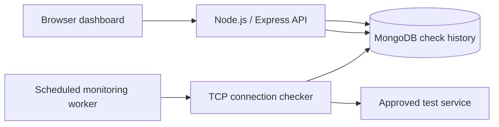

# JULIETT — NetGuard Designed Product Demo Runbook

**Project:** NetGuard  
**Owner / presenter:** Logan Tortorigi  
**Demo limit:** 10 minutes (aim for 9 minutes 30 seconds)  
**Format:** Demonstrate the app; do not use a slide deck or browse the repository as the main presentation.  
**Status at drafting (November 2, 2026):** **Planned runbook, not a verified live demo.** The repository currently contains the INDIA proposal and planning issues, but no NetGuard application code, verified deployment, or recorded outage/recovery evidence. Do not describe the steps below as already implemented.

## 1. Demo objective and user

**Opening question:** "If one of my cloud services goes offline, how would I know, and how could I tell when it came back?"

**User:** A student managing a few personally controlled cloud services.

**Problem:** Checking each server individually takes time and does not show when a service was unavailable.

**Product promise to demonstrate after implementation:** NetGuard checks an approved set of services, displays their most recent TCP reachability status, and records check history so an outage and recovery are visible.

**Important distinction:** A successful TCP connection shows that a port accepted a connection. It does **not** prove the application behind that port is functioning correctly.

## 2. Links and demo environment

| Item | Link or location |
| --- | --- |
| Main project repository | https://github.com/ltortorigi/netguard |
| Project proposal and requirements | [INDIA](india.md) |
| Development branch | https://github.com/ltortorigi/netguard/tree/dev |
| Work / acceptance criteria | https://github.com/ltortorigi/netguard/issues |
| Initialize app and database | https://github.com/ltortorigi/netguard/issues/2 |
| Service management and target restrictions | https://github.com/ltortorigi/netguard/issues/3 |
| TCP monitoring | https://github.com/ltortorigi/netguard/issues/4 |
| Scheduled checks and history | https://github.com/ltortorigi/netguard/issues/5 |
| Status and history dashboard | https://github.com/ltortorigi/netguard/issues/6 |
| Authentication and audit trail | https://github.com/ltortorigi/netguard/issues/7 |
| Outage/recovery tests | https://github.com/ltortorigi/netguard/issues/8 |
| Deployment and demo evidence | https://github.com/ltortorigi/netguard/issues/9 |
| DEV application URL | **Not yet deployed / verified** |
| Production application URL | **Not yet deployed / verified** |
| Demo login | **Not yet created.** Never put passwords in Git. |

**Safe test setup:** Use a disposable TCP service that you own and that the monitor is expressly allowed to check, ideally on the same host or a reachable test VM. Do not scan arbitrary classroom/public IP addresses. Prepare the service so you can deliberately start and stop it without affecting real users. If the monitor runs on another host, `127.0.0.1` refers to the monitor's host, *not* your laptop.

## 3. Planned live demonstration (9:30 total)

The actions here are a **script for the finished app**. The timing must be adjusted during a rehearsal once the software is working.

| Time | What the audience sees / presenter does | What to say |
| --- | --- | --- |
| **0:00–0:45 — Problem + user** | Open the NetGuard application directly. | "I manage cloud services, and I want to know if one is reachable without checking each server individually. NetGuard puts those checks and their history in one place." |
| **0:45–1:45 — Experience the product** | Sign in with a pre-created demo account. Show the dashboard and a pre-approved test service. | "This is my monitoring dashboard. It shows which services are reachable, when they were last checked, and the result of each check." |
| **1:45–2:45 — Set up one service** | Add or enable an approved disposable service. Point out that a new monitor begins in the **unknown** state until checked. | "I can add a service I control, rather than entering arbitrary Internet targets." |
| **2:45–3:45 — Healthy service** | With the disposable TCP listener running, wait for a real check. Show **reachable**, check time, and measured connection duration. | "The monitored port is accepting connections. This is the baseline before I simulate a failure." |
| **3:45–5:10 — Something interesting: outage** | Stop *only* the disposable service. Show the next actual failed check and its timestamp/error. | "Now the service stops accepting connections. NetGuard records a failure instead of leaving the last success looking current." |
| **5:10–6:30 — Recovery** | Restart the same service. Show the next successful check and the transition back to **reachable**. | "After I restart it, NetGuard records the recovery. The previous failure is still part of the history." |
| **6:30–7:15 — Persistence** | Refresh the page and open the service's history. Point to the sequence **reachable → unreachable → reachable**. | "These results survive a page refresh because the check records are stored in the database." |
| **7:15–8:20 — Behind the curtain** | Briefly switch to a simple architecture explanation and the specific implementation files **once they exist**. | "The browser reads the status from an Express API. A TCP checker tests approved targets, and MongoDB stores the observations." |
| **8:20–9:00 — Reality check** | Return to the app; point out a limitation. | "TCP reachability is not full application health, and checks on a schedule can miss outages between checks. This is a small personal monitor, not an enterprise security system." |
| **9:00–9:30 — What comes next** | Leave the dashboard visible. | "Next, I would add HTTP health checks and notifications. My goal is a useful monitoring tool and a project that demonstrates practical networking and backend development." |

**Audience participation (optional):** Invite someone to choose which of **two pre-approved disposable test services** to demonstrate. Do not let the audience supply arbitrary IP addresses, domains, or ports.

**Timing risk:** The project plan calls for checks about every 60 seconds with a five-second timeout. Three actual status transitions might exceed the planned demonstration times. Rehearse the whole sequence. If you cannot make it fit, play a short, **clearly labeled real recording** of the outage/recovery checks after first showing the live interface. Never substitute manually edited or fabricated monitoring history for real evidence.

## 4. Pre-demo checklist

Complete these **before** presenting the demo as working:

- [ ] Implement the application and confirm the project starts (Issue #2).
- [ ] Configure MongoDB without committing credentials.
- [ ] Require authentication for administration, and permit only approved monitoring targets (Issues #3 and #7).
- [ ] Implement safe TCP connection attempts, connection deadlines, and scheduled checks (Issues #4–5).
- [ ] Display **unknown**, **reachable**, **unreachable**, and **stale** states accurately, with timestamps and check history (Issue #6).
- [ ] Save checks in MongoDB and prove that history remains after refreshing.
- [ ] Verify a disposable service's **working → stopped → restarted** sequence and save real verification evidence (Issue #8).
- [ ] Publish and test a DEV or production app URL from the classroom presentation machine (Issue #9).
- [ ] Create a separate demo login, keep its password private, and test it beforehand.
- [ ] Start with a clean prepared demonstration record; do not delete unrelated user records.
- [ ] If using prerecorded evidence, label it and keep an offline local backup in case network access fails.
- [ ] Rehearse with a stopwatch and keep the total under 10 minutes.
- [ ] Update this runbook's unverified fields and script to match what is **actually** implemented.

## 5. Simple architecture to explain after the audience sees the product

**Planned architecture, not yet implemented.** Once the code exists, replace this note with precise links to the relevant frontend, checker, scheduler, API, database, authentication, and test files.

## 6. Controlled failure and backup path

**Happy path:** The test service is reachable → stop it → monitor records an outage → restart it → monitor records recovery → refresh to show retained history.

**If the live check is delayed:** Explain the configured polling interval and show the *latest actual result* rather than claiming that a pending check has run. Use a clearly identified real video clip, if recorded.

**If MongoDB or deployment is unavailable:** Do not claim a successful live demo. Explain the failure and, if available, show authentic earlier test or deployment evidence. Do not expose `.env`, database connection strings, tokens, or admin passwords.

**If the audience asks about security:** Explain that targets are restricted to approved hosts/ports and administration is intended to require authentication. Only claim these controls work after the linked implementation and tests exist.

## 7. Reality check and next steps

Current verified state at the time this file was written: proposal, research, issues, and GitHub branches only. The monitor, dashboard, authentication, and deployments are still to be built and verified.

**Limitations of the intended first version:** A successful TCP handshake alone cannot validate an application's business functionality; one-minute checks do not guarantee every brief outage is observed; monitoring is limited to deliberately approved targets; and the project initially targets one administrator and a small set of services.

**After a working first release:** Consider HTTP endpoint checks, downtime notifications, and optional SSH-login security analysis. Keep any new capability separate from the required working core.

**Completion evidence:** Link the deployed app, a passing test run, and the actual controlled failure/recovery proof here once available. The presentation should lead with those observable results, not the GitHub issue tracker.
